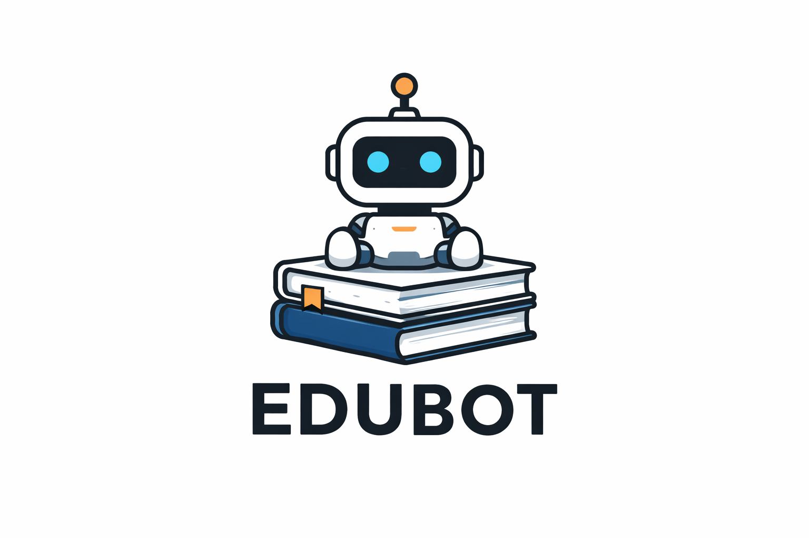
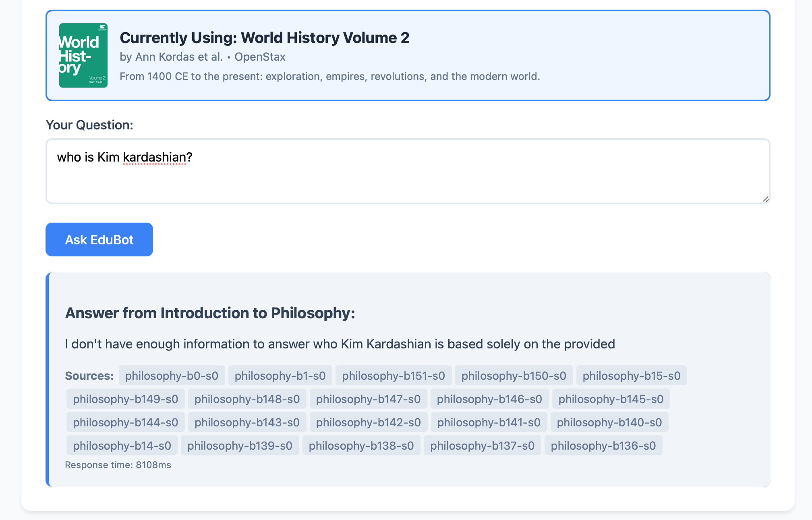

<div align="center">
  
</div>

# EduBot

Curriculum question-answering prototype using S3 indexes, a Python Lambda API, and model-generated responses.

The API retrieves textbook sections using keyword scores and includes them in the model prompt. Responses depend on retrieval results and the configured model.

## Features

- **Retrieval**: Keyword-scored sections from uploaded course materials
- **Model providers**: Gemini and Amazon Bedrock
- **Serverless Architecture**: AWS Lambda with container deployment
- **Frontend**: Book selection and question form
- **RAG Pipeline**: Keyword-scored retrieval + AI generation
- **Development**: Test runner and GitHub Actions workflow



## Architecture

- **API**: Python Lambda function with REST endpoints
- **Storage**: S3 for curriculum documents and processed indexes
- **AI**: Amazon Bedrock (Claude Haiku) for answer generation
- **Infrastructure**: IAM and KMS setup scripts
- **Monitoring**: CloudWatch metrics and custom dashboards
- **Deployment**: GitHub Actions CI/CD pipeline

## Quick Start

### Prerequisites
- AWS CLI configured
- Docker installed
- Python 3.12+

### 1. Deploy Infrastructure
```bash
git clone https://github.com/mjfxjas/edubot_mvp.git
cd edubot_mvp

# Set up AWS resources
source infra/00-variables.sh
./infra/10-kms-and-s3.sh
./infra/10-iam.sh
./infra/60-lambda-api.sh
```

### 2. Upload Curriculum
```bash
# Process and upload textbooks
python tools/indexer.py \
  --pdf /path/to/textbook.pdf \
  --book-id philosophy \
  --subject philosophy \
  --s3-bucket $CURRICULUM_BUCKET
```

### 3. Test the API
```bash
# Health check
curl https://your-lambda-url/health

# Ask a question
curl -X POST https://your-lambda-url/ask \
  -H "Content-Type: application/json" \
  -d '{"question": "What is philosophy?", "book_id": "philosophy"}'
```

## API Endpoints

- `GET /health` - System health and dependency status
- `GET /indexes` - List available curriculum indexes
- `POST /ask` - Ask questions based on curriculum; malformed JSON or invalid question/book IDs return HTTP 400.

Sources identify only successfully loaded, distinct sections. Book IDs accept
1–64 letters, numbers, underscores, or hyphens.

## Development

### Local Testing
```bash
# Run the offline regression suite (AWS clients are mocked)
python run_tests.py

# Test locally with mock mode
MOCK_BEDROCK=true python -c "
import sys; sys.path.append('src/api')
import handler, json
event = {'httpMethod': 'POST', 'path': '/ask', 'body': json.dumps({'question': 'test'})}
print(handler.lambda_handler(event, None))
"
```

### CI/CD Pipeline
Pushes to `main` run tests and lint. When `AWS_DEPLOY_ROLE_ARN` is configured, the workflow also builds and publishes the image and updates Lambda:
1. Automated testing
2. Code quality checks
3. Docker build and ECR push
4. Lambda function update

## Configuration

### Environment Variables
- `CURRICULUM_BUCKET` - S3 bucket for curriculum data
- `INDEX_PREFIX` - S3 prefix for processed indexes
- `TOP_K` - Number of sections to retrieve (default: 20)
- `BEDROCK_MODEL` - AI model ID (default: claude-3-haiku)
- `GEMINI_API_KEY` - Optional Google Gemini API key
- `MOCK_BEDROCK` - Enable mock mode for development

### Security
- Infrastructure scripts configure KMS encryption for curriculum storage
- IAM roles define access to curriculum data and model services
- Gemini requests send prompt content to Google when that provider is used

## Monitoring

- CloudWatch metrics for invocations, errors, and latency
- Custom dashboard for system health
- Structured logging with request tracking
- Automated alerts for error rates and performance

## Documentation

- [Cost Notes](docs/COSTS.md)
- [API Documentation](docs/API.md)
- [Deployment Guide](docs/DEPLOYMENT.md)
- [Security Considerations](SECURITY.md)
- [Development Journal](docs/dev-journal.md)

## Current Books

- **Introduction to Philosophy** - OpenStax
- **World History Volume 1** - Prehistory to 1500 CE
- **World History Volume 2** - 1400 CE to Present

## Limitations

Retrieval uses keyword scores and can miss relevant sections. Responses are not
guaranteed to stay within the curriculum. Provider limits can trigger fallback
behavior, and requests are not cached.

## License

MIT License - see LICENSE file for details.
